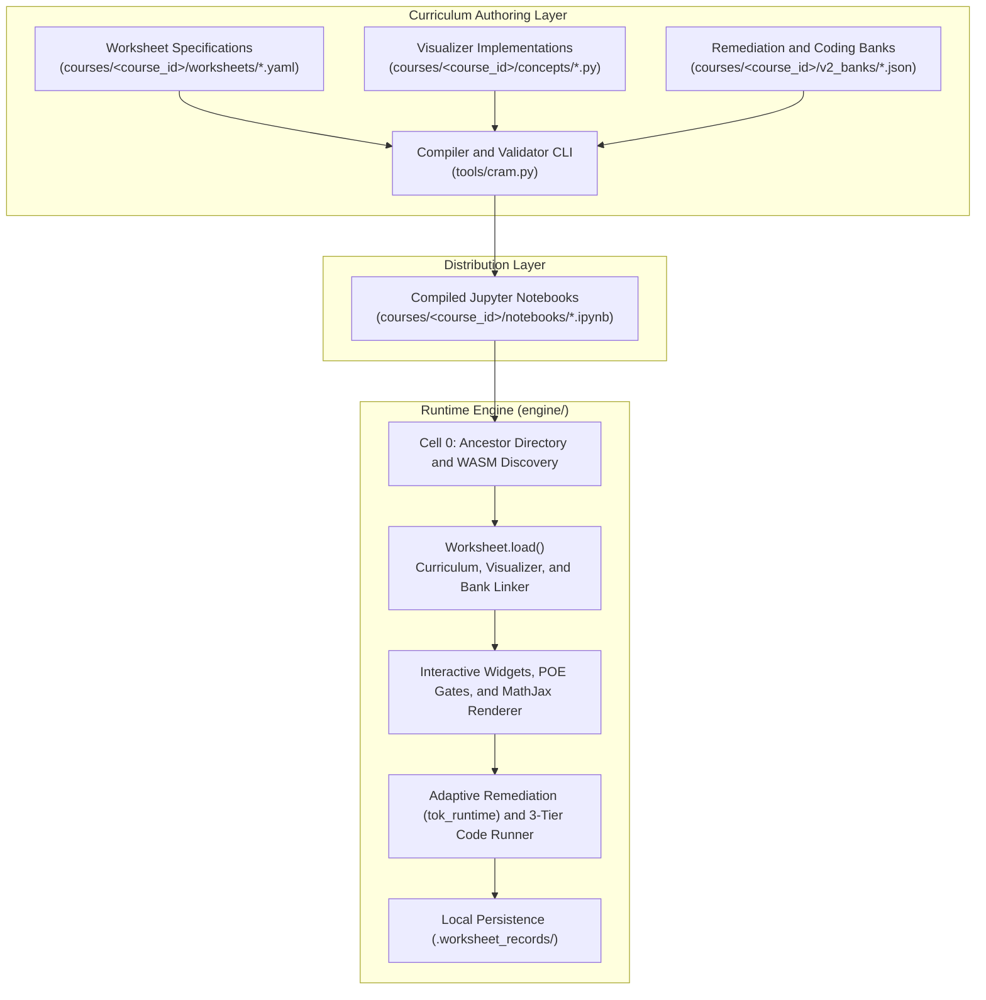
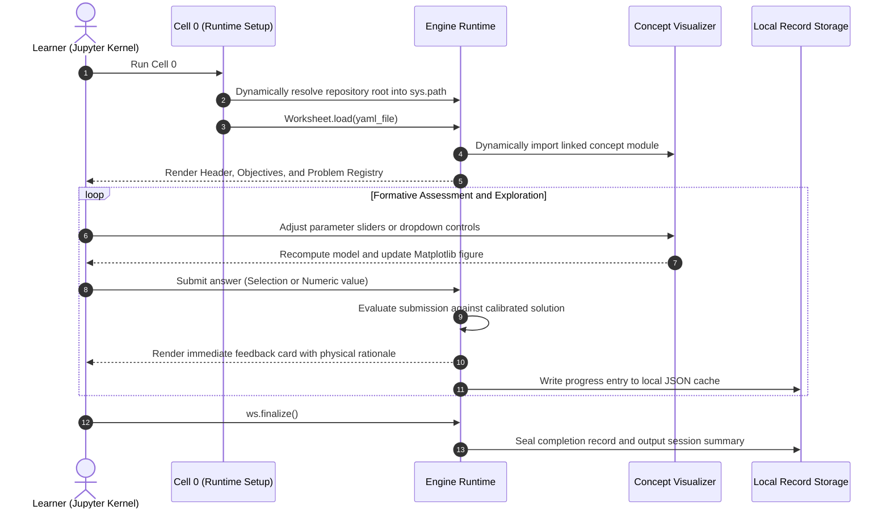

# Interactive Scientific Worksheet Framework

A modular, zero-configuration framework for developing and distributing interactive computational science worksheets. The platform compiles declarative curriculum specifications, dynamic visualization scripts, adaptive prerequisite remediation banks, and scientific coding suites into standalone, pre-rendered Jupyter notebooks featuring live parameter exploration, instantaneous diagnostic assessment, embedded code verification, and mathematical typesetting across local desktop Jupyter and browser WebAssembly (JupyterLite).

---

## Pedagogical Rationale

Traditional STEM lecture distribution relies heavily on passive consumption of slides and static textbook problems. This framework is engineered around core principles of cognitive engagement and computational inquiry:

### 1. Active Recall, Confidence Calibration, and Formative Assessment
Each lesson is structured around 35 to 50 targeted conceptual, analytical, and quantitative problems paired with optional confidence-based marking. Rather than functioning solely as summative evaluations, problems provide immediate diagnostic feedback upon submission. Correctness assessments are accompanied by detailed rationales explaining underlying physical principles, derivations, and common conceptual pitfalls, while multi-tier hints provide progressive scaffolding without prematurely disclosing solutions.

### 2. Live Parameter Exploration and Predict-Observe-Explain Gating
Static figures are replaced with dynamic visualizers constructed using Matplotlib and `ipywidgets`. Learners manipulate continuous and discrete system parameters (e.g., thermodynamic temperatures, interatomic potential cutoffs, boundary conditions, or lattice coupling constants) and observe physical responses in real time. During targeted remediation, Predict-Observe-Explain (POE) exploration gating prompts learners to commit to a physical prediction and explore multiple parameter regimes before revealing synthesis takeaways.

### 3. Adaptive Conceptual Remediation and Learner Agency
When a submission reveals a specific conceptual or analytical gap, an inline prerequisite remediation automaton administers a lightweight diagnostic probe and, when needed, opens a focused conceptual remediation cluster containing refutation explanations, backward-faded worked derivations, POE-gated visualizers, and graduated mastery checks. Continuous learner mastery, uncertainty, and memory stability states evolve across prerequisite graphs and course knowledge vectors. Throughout deep remediation, learners retain explicit agency via optional **"Continue Down the Rabbit Hole"** multi-step prerequisite exploration (guarded against cycles and bounded in depth) alongside a trigger-gated **"Return to Worksheet"** control that unwinds cleanly to an isomorphically refreshed root problem while logging deferred concepts for spaced review.

### 4. Embedded Scientific Python Coding Verification
Each module integrates pure-function scientific Python and NumPy programming exercises graded directly inside the notebook via `ws.check_code()`. An AST-guarded execution runner with loop-tick protection evaluates student implementations across a 3-tier verification suite—interface and unit contracts, randomized physical-invariant oracles, and sealed reference vectors—providing diagnostic feedback without exposing reference solutions in either local CPython (JupyterLab) or browser WebAssembly (Pyodide / JupyterLite).

### 5. Precision Mathematical Typography
All prompts, options, and explanatory cards natively support MathJax LaTeX rendering with robust physical unit formatting (including Unicode symbols such as the Angstrom). Math environments are isolated during markdown processing to prevent syntax corruption.

### 6. Persistent Local State and Mastery Tracking
Student progress, spaced-review urgency, and course knowledge vector mastery states are saved locally in machine-readable JSON records with integrity digests. State persists across kernel restarts and browser refreshes, allowing learners to track completion percentages, inspect cross-module mastery profiles, and review historical submissions via dedicated inspection routines.

---

## System Architecture

The repository enforces strict separation between curriculum definitions, visualization logic, course administration tools, and the universal runtime engine.

### Directory Structure

```text
├── engine/                       # Universal worksheet execution runtime
│   ├── __init__.py               # Public package API
│   ├── worksheet.py              # Dynamic loader, widget builder, and grading engine
│   ├── tok_runtime.py            # Adaptive prerequisite remediation automaton & learner mastery engine
│   ├── code_runner.py            # AST-guarded 3-tier scientific code verification engine (CPython & WASM)
│   ├── plot_style.py             # Visual styling, palettes, and graph rendering
│   └── figures.py                # Static and shared diagram rendering
│
├── courses/                      # Multi-course curriculum root
│   └── <course_id>/              # Isolated course module (e.g., "Atomic Scale Simulations")
│       ├── course.yaml           # Course metadata, title, and module registry
│       ├── worksheets/           # Declarative YAML and JSON curriculum specifications
│       ├── concepts/             # Python visualization functions for interactive cells
│       ├── v2_banks/             # Prerequisite graph (course_fragility_and_kvs.json) & lesson_*.v2.json banks
│       └── notebooks/            # Pre-compiled, standalone Jupyter notebooks
│
├── tools/                        # Administrative CLI tools
│   └── cram.py                   # Verification, compilation, and ingestion CLI
│
├── templates/                    # Authoring templates for new courses and modules
│   ├── course.yaml.template
│   ├── lesson_template.yaml
│   └── concept_template.py
│
├── requirements.txt              # Standard Python dependencies
└── .gitignore                    # Automated exclusion of raw course materials
```

### Architectural Pipeline



### Execution Lifecycle

When a student executes a worksheet in Jupyter, the runtime operates through a distinct sequence:



### Key Design Principles

- **Zero-Configuration Runtime Portability**:
  Each compiled notebook includes an ancestor discovery header in its initialization cell. The header recursively searches parent directories for the root `engine/` package and injects it into `sys.path`. Notebooks execute seamlessly in JupyterLab, VS Code, Google Colab, or containerized environments without running `pip install -e .` or configuring system-level `.pth` paths.
- **Declarative Curriculum Definitions**:
  All questions, options, hints, numerical tolerances, and explanations reside in human-readable YAML specifications. Curriculum updates require no modification to underlying Python code.
- **Resource and Material Isolation**:
  Original course slide decks, copyrighted handouts, and raw lecture notes remain strictly quarantined in local `resources/` directories and are excluded from Git version control via `.gitignore`. Published repositories contain only self-contained YAML declarations, Python visualizers, and notebooks, requiring zero access to source documents.

---

## End-User Instructions

### Mode 1: Instant In-Browser Access (Zero Installation)

For learners who do not have a local Python environment configured, the entire curriculum runs directly in the browser via WebAssembly (JupyterLite) with zero installation:

- **Launch Live Worksheets**:
  Navigate to the repository's GitHub Pages deployment:
  `https://<organization>.github.io/<repository>/lab/index.html`
- **Enabling GitHub Pages Deployment** (Repository Administrators):
  1. In the repository on GitHub, navigate to **Settings** -> **Pages**.
  2. Under **Build and deployment** -> **Source**, select **GitHub Actions**.
  3. Pushes to `main` automatically trigger `.github/workflows/deploy.yml` to compile and publish the latest static site.

---

### Mode 2: Local Desktop Environment

#### Prerequisites

- Python 3.9 or higher
- Standard scientific Python libraries: `jupyterlab` (or `notebook`), `ipywidgets`, `matplotlib`, `numpy`, `pyyaml`, and `nbformat`.

#### Installation

1. **Clone the repository**:
   ```bash
   git clone <repository-url>
   cd <repository-directory>
   ```

2. **Install required dependencies**:
   ```bash
   pip install -r requirements.txt
   ```

3. **Launch the Jupyter environment**:
   ```bash
   jupyter lab
   ```
   *(Alternatively, `jupyter notebook` may be used).*

---

## Learner Workflow

1. Navigate to `courses/<course_id>/notebooks/` (e.g., `courses/Atomic Scale Simulations/notebooks/`).
2. Open any `.ipynb` file in local JupyterLab or in browser-based JupyterLite.
3. **Execute Cell 1**: Initializes the session, configures uniform visual styling, restores any saved mastery state, displays module metadata, and lists target learning objectives.
4. **Interact with Concept Cells**: Adjust control sliders and dropdown menus to explore physical behavior before attempting corresponding questions.
5. **Submit Answers and Engage Adaptive Remediation**:
   - For single-select and multi-select questions, select option choices; for quantitative questions, enter numerical values; optionally record your response confidence.
   - Click **Submit Answer** to evaluate. An immediate response card displays analytical derivations, physical explanations, and tiered hints (**Show hint**).
   - When a tractable prerequisite gap is detected, complete the inline **Diagnostic Probe** and, if needed, the **Conceptual Remediation Cluster** (featuring refutation guidance, faded worked steps, Predict-Observe-Explain visualizer exploration gating, and graduated mastery checks).
   - If deeper upstream gaps arise during remediation, choose **"Continue Down the Rabbit Hole"** for optional multi-depth prerequisite exploration, or click the trigger-gated **"Return to Worksheet"** button at any point after activation to unwind cleanly to a refreshed root problem while logging deferred topics for spaced review.
6. **Complete Embedded Coding Exercises**:
   - Implement the scientific Python / NumPy function in each coding cell and execute the paired `ws.check_code(exercise_id, fn)` verification cell.
   - Review immediate 3-tier feedback across contract/unit checks, randomized physical-invariant tests, and sealed reference vectors (with automatic prerequisite remediation routing when conceptual simulation bugs are detected).
7. **Conclude Session**:
   - Execute the final cells:
     - `ws.show_record()`: Displays a summary table of attempted questions, coding exercises, and mastery across course knowledge vectors.
     - `ws.finalize()`: Seals and writes completion state and integrity receipts to `.worksheet_records/`.

---

## Curriculum Management and Developer CLI

The administrative tool `tools/cram.py` manages verification, compilation, and scaffolding across all courses:

### List Registered Courses
Displays all active courses configured under `courses/`:
```bash
python tools/cram.py list
```

### Validate Curriculum Integrity
Verifies question quotas ($35 \le N_Q \le 50$), checks learning objective links, validates answer schemas, and executes all interactive visualizer functions across minimum, default, and maximum parameter ranges:
```bash
# Validate a specific course
python tools/cram.py verify "Atomic Scale Simulations"

# Validate all courses across the repository
python tools/cram.py verify all
```

### Compile Standalone Notebooks
Builds `.ipynb` notebooks from YAML specifications and Python concept modules with pre-rendered static outputs:
```bash
# Compile a specific course
python tools/cram.py build "Atomic Scale Simulations"

# Compile all courses
python tools/cram.py build all
```

### Curriculum Summary
Prints a structural summary table displaying question counts, concept visualizers, and section breakdowns:
```bash
python tools/cram.py summary "Atomic Scale Simulations"
```

### Scaffold a New Course
Initializes a new course module directory hierarchy using standard templates:
```bash
python tools/cram.py ingest <new_course_id>
```

---

## Reference Course Implementation

This repository contains a complete reference implementation: **Atomic Scale Simulations**. It consists of **24 interactive modules**, comprising **983 calibrated problems**, **89 dynamic visualizers**, **210 adaptive concept remediation clusters** (with **391 diagnostic probes**) organized across **8 course knowledge vectors**, and **72 embedded scientific Python coding exercises** backed by **360 unit tests**:

| Module Sequence | Curricular Scope | Key Dynamic Visualizers |
| :--- | :--- | :--- |
| **Lessons 01–04** | Statistical foundations, phase space, correlation errors, MD numerical integrators | Velocity Verlet trajectory error, Maxwell-Boltzmann velocity distributions |
| **Lessons 05–08** | Periodic boundary conditions, neighbor lists, empirical potentials, force derivatives, DFT foundations | Minimum image convention, Verlet neighbor lists, Lennard-Jones vs. Buckingham potentials, Kohn-Sham functional sweeps |
| **Lessons 09–11** | Static structure factors, dynamical transport coefficients, velocity autocorrelation, thermostats | Radial distribution functions $g(r)$, Green-Kubo diffusion integration, Andersen and Berendsen temperature coupling |
| **Lessons 12–16** | Monte Carlo foundations, pseudorandom number generator testing, sampling variance, Markov chains, smart MC | Chi-square PRNG uniform testing, Metropolis acceptance envelopes, Force-biased displacement drift |
| **Lessons 17–20** | Brownian and Langevin dynamics, dissipative particle dynamics, Ewald long-range electrostatics, holonomic SHAKE constraints, free energy perturbation | Langevin friction-noise balance, Ewald real vs. reciprocal sum convergence, SHAKE iterative bond tolerance, Bennett acceptance ratio |
| **Lessons 21–24** | Polymer scaling models, 2D Ising lattices, finite-size renormalization scaling, kinetic Monte Carlo | Self-avoiding random walks, Metropolis spin-flip lattice kinetics, Binder cumulant crossing, Poisson residence-time vacancy diffusion |

---

## Technical Specifications

- **Compatibility**: Python 3.9 through 3.14.
- **Frontend Support**: JupyterLab 3+, Classic Jupyter Notebook 6+, VS Code Jupyter Extension, Google Colab.
- **Storage Protocol**: Local filesystem JSON persistence; zero remote network dependencies.
