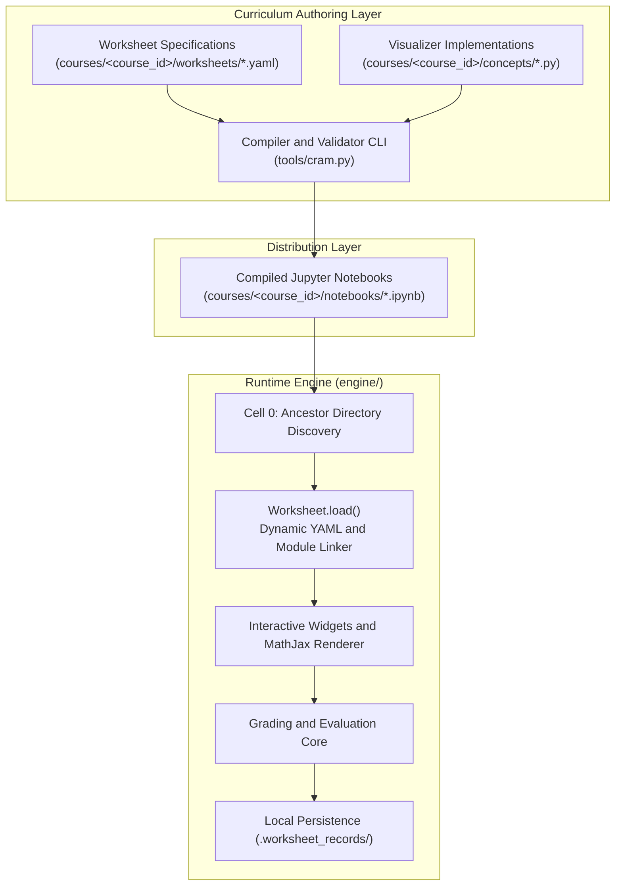
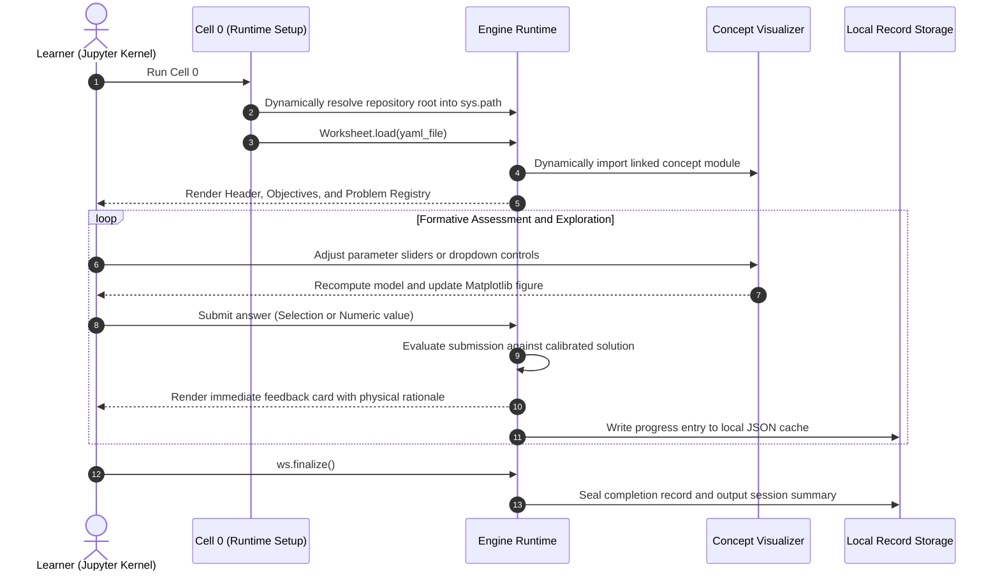

# Interactive Scientific Worksheet Framework

A modular, zero-configuration framework for developing and distributing interactive computational science worksheets. The platform compiles declarative curriculum specifications and interactive visualization scripts into standalone, pre-rendered Jupyter notebooks featuring live parameter exploration, instantaneous assessment, and mathematical typesetting.

---

## Pedagogical Rationale

Traditional STEM lecture distribution relies heavily on passive consumption of slides and static textbook problems. This framework is engineered around core principles of cognitive engagement and computational inquiry:

### 1. Active Recall and Formative Assessment
Each lesson is structured around 35 to 50 targeted conceptual, analytical, and quantitative problems. Rather than functioning solely as summative evaluations, problems provide immediate feedback upon submission. Correctness assessments are accompanied by detailed rationales explaining underlying physical principles, derivations, and common conceptual pitfalls. Optional hints provide tiered scaffolding without prematurely disclosing solutions.

### 2. Live Parameter Exploration
Static figures are replaced with dynamic visualizers constructed using Matplotlib and `ipywidgets`. Learners manipulate continuous and discrete system parameters (e.g., thermodynamic temperatures, interatomic potential cutoffs, boundary conditions, or lattice coupling constants) and observe physical responses in real time. This bridges analytical theory and computational modeling by allowing immediate empirical validation of theoretical limits.

### 3. Precision Mathematical Typography
All prompts, options, and explanatory cards natively support MathJax LaTeX rendering with robust physical unit formatting (including Unicode symbols such as the Angstrom). Math environments are isolated during markdown processing to prevent syntax corruption.

### 4. Persistent Local State
Student progress is saved locally in machine-readable JSON records. State persists across kernel restarts and browser refreshes, allowing learners to track completion percentages and review historical submissions via dedicated inspection routines.

---

## System Architecture

The repository enforces strict separation between curriculum definitions, visualization logic, course administration tools, and the universal runtime engine.

### Directory Structure

```text
├── engine/                       # Universal worksheet execution runtime
│   ├── __init__.py               # Public package API
│   ├── worksheet.py              # Dynamic loader, widget builder, and grading engine
│   ├── plot_style.py             # Visual styling, palettes, and graph rendering
│   └── figures.py                # Static and shared diagram rendering
│
├── courses/                      # Multi-course curriculum root
│   └── <course_id>/              # Isolated course module (e.g., mse_485)
│       ├── course.yaml           # Course metadata, title, and module registry
│       ├── worksheets/           # Declarative YAML curriculum specifications
│       ├── concepts/             # Python visualization functions for interactive cells
│       └── notebooks/            # Pre-compiled, standalone Jupyter notebooks
│
├── tools/                        # Administrative CLI tools
│   └── cram.py                   # Verification, compilation, and ingestion CLI
│
├── templates/                    # Authoring templates for new courses and modules
│   ├── course.yaml.template
│   ├── lesson_template.yaml
│   └── concept_template.py
│
├── requirements.txt              # Standard Python dependencies
└── .gitignore                    # Automated exclusion of raw course materials
```

### Architectural Pipeline



### Execution Lifecycle

When a student executes a worksheet in Jupyter, the runtime operates through a distinct sequence:



### Key Design Principles

- **Zero-Configuration Runtime Portability**:
  Each compiled notebook includes an ancestor discovery header in its initialization cell. The header recursively searches parent directories for the root `engine/` package and injects it into `sys.path`. Notebooks execute seamlessly in JupyterLab, VS Code, Google Colab, or containerized environments without running `pip install -e .` or configuring system-level `.pth` paths.
- **Declarative Curriculum Definitions**:
  All questions, options, hints, numerical tolerances, and explanations reside in human-readable YAML specifications. Curriculum updates require no modification to underlying Python code.
- **Resource and Material Isolation**:
  Original course slide decks, copyrighted handouts, and raw lecture notes remain strictly quarantined in local `resources/` directories and are excluded from Git version control via `.gitignore`. Published repositories contain only self-contained YAML declarations, Python visualizers, and notebooks, requiring zero access to source documents.

---

## End-User Instructions

### Mode 1: Instant In-Browser Access (Zero Installation)

For learners who do not have a local Python environment configured, the entire curriculum runs directly in the browser via WebAssembly (JupyterLite) with zero installation:

- **Launch Live Worksheets**:
  Navigate to the repository's GitHub Pages deployment:
  `https://<organization>.github.io/<repository>/lab/index.html`
- **Enabling GitHub Pages Deployment** (Repository Administrators):
  1. In the repository on GitHub, navigate to **Settings** -> **Pages**.
  2. Under **Build and deployment** -> **Source**, select **GitHub Actions**.
  3. Pushes to `main` automatically trigger `.github/workflows/deploy.yml` to compile and publish the latest static site.

---

### Mode 2: Local Desktop Environment

#### Prerequisites

- Python 3.9 or higher
- Standard scientific Python libraries: `jupyterlab` (or `notebook`), `ipywidgets`, `matplotlib`, `numpy`, `pyyaml`, and `nbformat`.

#### Installation

1. **Clone the repository**:
   ```bash
   git clone <repository-url>
   cd <repository-directory>
   ```

2. **Install required dependencies**:
   ```bash
   pip install -r requirements.txt
   ```

3. **Launch the Jupyter environment**:
   ```bash
   jupyter lab
   ```
   *(Alternatively, `jupyter notebook` may be used).*

---

## Learner Workflow

1. Navigate to `courses/<course_id>/notebooks/` (e.g., `courses/mse_485/notebooks/`).
2. Open any `.ipynb` file.
3. **Execute Cell 1**: Initializes the session, configures uniform visual styling, displays module metadata, and lists target learning objectives.
4. **Interact with Concept Cells**: Adjust control sliders and dropdown menus to explore physical behavior before attempting corresponding questions.
5. **Submit Answers**:
   - For single-select and multi-select questions, select option checkboxes.
   - For quantitative questions, enter numerical values.
   - Click **Submit Answer** to evaluate. An immediate response card displays whether the answer was correct, along with an analytical derivation and physical explanation.
   - Use the **Show hint** toggle if conceptual assistance is required.
6. **Conclude Session**:
   - Execute the final cells:
     - `ws.show_record()`: Displays a summary table of attempted questions and overall score.
     - `ws.finalize()`: Encrypts and writes completion state to `.worksheet_records/`.

---

## Curriculum Management and Developer CLI

The administrative tool `tools/cram.py` manages verification, compilation, and scaffolding across all courses:

### List Registered Courses
Displays all active courses configured under `courses/`:
```bash
python tools/cram.py list
```

### Validate Curriculum Integrity
Verifies question quotas ($35 \le N_Q \le 50$), checks learning objective links, validates answer schemas, and executes all interactive visualizer functions across minimum, default, and maximum parameter ranges:
```bash
# Validate a specific course
python tools/cram.py verify mse_485

# Validate all courses across the repository
python tools/cram.py verify all
```

### Compile Standalone Notebooks
Builds `.ipynb` notebooks from YAML specifications and Python concept modules with pre-rendered static outputs:
```bash
# Compile a specific course
python tools/cram.py build mse_485

# Compile all courses
python tools/cram.py build all
```

### Curriculum Summary
Prints a structural summary table displaying question counts, concept visualizers, and section breakdowns:
```bash
python tools/cram.py summary mse_485
```

### Scaffold a New Course
Initializes a new course module directory hierarchy using standard templates:
```bash
python tools/cram.py ingest <new_course_id>
```

---

## Reference Course Implementation

This repository contains a reference implementation: **MSE 485: Atomic Scale Simulations**. It consists of 24 interactive modules, comprising 983 calibrated problems and 89 dynamic visualizers:

| Module Sequence | Curricular Scope | Key Dynamic Visualizers |
| :--- | :--- | :--- |
| **Lessons 01–04** | Statistical foundations, phase space, correlation errors, MD numerical integrators | Velocity Verlet trajectory error, Maxwell-Boltzmann velocity distributions |
| **Lessons 05–08** | Periodic boundary conditions, neighbor lists, empirical potentials, force derivatives, DFT foundations | Minimum image convention, Verlet neighbor lists, Lennard-Jones vs. Buckingham potentials, Kohn-Sham functional sweeps |
| **Lessons 09–11** | Static structure factors, dynamical transport coefficients, velocity autocorrelation, thermostats | Radial distribution functions $g(r)$, Green-Kubo diffusion integration, Andersen and Berendsen temperature coupling |
| **Lessons 12–16** | Monte Carlo foundations, pseudorandom number generator testing, sampling variance, Markov chains, smart MC | Chi-square PRNG uniform testing, Metropolis acceptance envelopes, Force-biased displacement drift |
| **Lessons 17–20** | Brownian and Langevin dynamics, dissipative particle dynamics, Ewald long-range electrostatics, holonomic SHAKE constraints, free energy perturbation | Langevin friction-noise balance, Ewald real vs. reciprocal sum convergence, SHAKE iterative bond tolerance, Bennett acceptance ratio |
| **Lessons 21–24** | Polymer scaling models, 2D Ising lattices, finite-size renormalization scaling, kinetic Monte Carlo | Self-avoiding random walks, Metropolis spin-flip lattice kinetics, Binder cumulant crossing, Poisson residence-time vacancy diffusion |

---

## Technical Specifications

- **Compatibility**: Python 3.9 through 3.14.
- **Frontend Support**: JupyterLab 3+, Classic Jupyter Notebook 6+, VS Code Jupyter Extension, Google Colab.
- **Storage Protocol**: Local filesystem JSON persistence; zero remote network dependencies.
